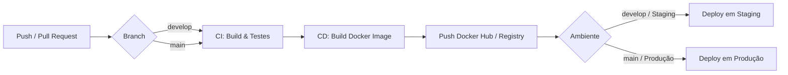

# 🌱 Projeto - Cidades ESG Inteligentes (Carbono API)

> **API RESTful e Infraestrutura DevOps para Gestão de Sustentabilidade, Emissões de Carbono e Metas ESG em Cidades Inteligentes.**

---

## 📋 Informações Acadêmicas e Integrantes

- **Instituição:** FIAP
- **Disciplina:** DevOps & Cloud Computing / Continuous Delivery
- **Projeto:** Cidades ESG Inteligentes - API de Gestão de Carbono (`carbono-api`)

---

## 🚀 Como executar localmente com Docker

A aplicação foi totalmente containerizada e orquestrada para simular um ambiente de produção real com persistência de dados e segregação de redes.

### Pré-requisitos
- [Docker Desktop](https://www.docker.com/products/docker-desktop/) instalado e em execução.
- [Git](https://git-scm.com/) instalado.

### Passo a passo para execução:

1. **Acesse a pasta do projeto:**
   ```bash
   cd carbono-api
   ```

2. **Configure o arquivo de variáveis de ambiente:**
   Copie o modelo de ambiente existente:
   ```bash
   cp .env.example .env
   # No Windows (PowerShell):
   Copy-Item .env.example .env
   ```

3. **Inicie os serviços com Docker Compose:**
   ```bash
   docker compose up --build -d
   ```
   > Esse comando irá construir a imagem Docker otimizada da aplicação, baixar a imagem do Oracle Database 23ai Free, criar a rede isolada `esg_network`, o volume de dados persistente `oracle_data` e inicializar o container da API aguardando o status de saúde (*healthy*) do banco.

4. **Verifique o status dos contêineres:**
   ```bash
   docker compose ps
   ```

5. **Acompanhe os logs da aplicação:**
   ```bash
   docker compose logs -f carbono-api
   ```

6. **Acesse a API:**
   - **URL Base:** `http://localhost:8080/api/v1`
   - **Login inicial:** `POST http://localhost:8080/api/v1/auth/login`
     - Body JSON:
       ```json
       {
         "email": "admin@esg.com",
         "senha": "admin123"
       }
       ```

7. **Encerrar a execução:**
   ```bash
   docker compose down
   # Para remover também os volumes persistentes:
   docker compose down -v
   ```

---

## 🔄 Pipeline CI/CD

O fluxo de Integração Contínua (CI) e Entrega Contínua (CD) foi implementado utilizando **GitHub Actions**, seguindo as melhores práticas do modelo de branching **GitFlow**:



### Ferramentas Utilizadas:
- **GitHub Actions:** Orquestração completa de pipelines.
- **Maven & Temurin JDK 21:** Build e execução automatizada de testes unitários.
- **Docker Buildx & Docker Hub:** Construção multi-stage de imagens de contêiner e registro seguro.
- **GitHub Environments & Secrets:** Segregação rígida dos ambientes `staging` e `production`.

### Etapas do Pipeline:

1. **Continuous Integration (`continuous-integration.yaml`):**
   - **Gatilho:** Disparado em todo `pull_request` e `push` direcionado às branches `develop` e `main`.
   - **Build Automático:** Execução de `mvn clean compile` para validar sintaxe e integridade do código fonte.
   - **Testes Automatizados:** Execução de `mvn test`, cobrindo testes unitários e de integração com Mockito e JUnit 5 com banco em memória H2 (garantindo que o CI não falhe por ausência de banco externo e execute com altíssima velocidade).
   - **Publicação de Artefatos:** Armazenamento automático do relatório Surefire com os resultados dos testes.

2. **Continuous Delivery (`continuous-delivery.yaml`):**
   - **Gatilho:** Disparado em pushes nas branches `develop` e `main`, com suporte a execução manual via `workflow_dispatch`.
   - **Build & Tag da Imagem Docker:** Gera as tags específicas por ambiente:
     - Para Staging: `:staging` e `:staging-<commit_sha>`
     - Para Produção: `:production`, `:<commit_sha>` e `:latest`
   - **Deploy Automatizado em Dois Ambientes:**
     - **Ambiente Staging:** Publicação automatizada ao mesclar alterações na branch `develop`, permitindo homologação de novos recursos.
     - **Ambiente Produção:** Publicação automatizada ao mesclar na branch `main`, aplicando as regras de governança e validação de release.

---

## 🐳 Containerização

A estratégia de containerização adotada utiliza **Multi-Stage Build** no Dockerfile para garantir máxima segurança, performance e imagens enxutas para produção.

### Conteúdo do `Dockerfile`:
```dockerfile
# Estágio 1: Build (Ambiente de compilação)
FROM maven:3.9.6-eclipse-temurin-21 AS build
WORKDIR /app
COPY pom.xml .
# Cache das dependências em camada separada para acelerar builds subsequentes
RUN mvn dependency:go-offline -B
COPY src ./src
RUN mvn clean package -DskipTests

# Estágio 2: Runtime (Ambiente final de produção leve e seguro)
FROM eclipse-temurin:21-jre-jammy
WORKDIR /app
COPY --from=build /app/target/carbono-api-0.0.1-SNAPSHOT.jar app.jar
EXPOSE 8080
ENTRYPOINT ["java", "-jar", "app.jar"]
```

### Estratégias Adotadas:
- **Multi-Stage Build:** Separa as ferramentas pesadas de compilação (Maven e JDK completo) do contêiner final em execução, resultando em uma imagem final reduzida contendo apenas o JRE (`eclipse-temurin:21-jre-jammy`).
- **Cache Otimizado:** A diretiva `COPY pom.xml` seguida de `mvn dependency:go-offline` garante que as dependências sejam cacheadas e reutilizadas em builds sem alteração no POM.
- **Isolamento de Infraestrutura (Compose):**
  - **Rede `esg_network`:** Isolamento da comunicação interna entre aplicação e banco.
  - **Volume `oracle_data`:** Persistência dos dados independente do ciclo de vida dos contêineres.
  - **Condição `service_healthy`:** A API aguarda a inicialização e saúde do banco Oracle antes de subir.
  - **Variáveis de Ambiente (`.env`):** Segredos e configurações desacopladas do código-fonte.

---

## 📸 Prints do Funcionamento

> As evidências de execução estão organizadas na pasta [`docs/evidencias/`](docs/evidencias/).

1. **Execução Local (Docker Compose up):**
   - Containers `esg_oracle_db` e `esg_carbono_api` em execução.
   - Evidência: `docs/evidencias/01-docker-compose-up.png`

2. **Execução dos Testes Automatizados no Pipeline (CI):**
   - Etapa do GitHub Actions executando com sucesso: `mvn test` (9 testes concluídos com sucesso).
   - Evidência: `docs/evidencias/02-github-actions-ci-tests.png`

3. **Deploy Automatizado em Staging:**
   - Pipeline de entrega contínua executando deploy para o ambiente de Staging.
   - Evidência: `docs/evidencias/03-deploy-staging.png`

4. **Deploy Automatizado em Produção:**
   - Pipeline de entrega contínua executando deploy para o ambiente de Produção.
   - Evidência: `docs/evidencias/04-deploy-production.png`

5. **Visão Geral Deploy Automatizado Staging e Produção:**
   - Pipeline de entrega contínua Staging e Produção.
   - Evidência: `docs/evidencias/05-deploy-production.png`

6. **API em Funcionamento:**
   - Requisição de autenticação e retorno do token JWT.
   - Evidência: `docs/evidencias/05-api-postman-jwt.png`

---

## 💻 Tecnologias Utilizadas

| Categoria | Tecnologia | Versão | Finalidade |
|---|---|---|---|
| **Linguagem & Plataforma** | Java | 21 (LTS) | Linguagem de programação principal |
| **Framework** | Spring Boot | 3.5.14 | Desenvolvimento da API RESTful |
| **Segurança** | Spring Security & JJWT | 0.12.5 | Autenticação stateless via tokens JWT |
| **Banco de Dados** | Oracle Database Free | 23ai | Banco de dados relacional principal |
| **Banco de Testes** | H2 Database | 2.3.x | Banco de dados in-memory para testes em CI |
| **Migrations** | Flyway | 11.x | Versionamento automatizado de banco |
| **Testes** | JUnit 5 & Mockito | 5.x / 1.17 | Testes unitários automatizados |
| **Containerização** | Docker & Dockerfile | 29.x | Criação de imagens multi-stage |
| **Orquestração** | Docker Compose | 3.8+ | Orquestração de múltiplos serviços locais |
| **CI/CD** | GitHub Actions | v4 | Automação de Integração e Deploy Contínuo |
| **Registro de Imagens** | Docker Hub | - | Repositório público/privado de contêineres |

---

## ✅ Checklist de Entrega

| Item | OK |
|---|:---:|
| Projeto compactado em .ZIP com estrutura organizada | ☑ |
| Dockerfile funcional | ☑ |
| docker-compose.yml ou arquivos Kubernetes | ☑ |
| Pipeline com etapas de build, teste e deploy | ☑ |
| README.md com instruções e prints | ☑ |
| Documentação técnica com evidências (PDF ou PPT) | ☑ |
| Deploy realizado nos ambientes staging e produção | ☑ |